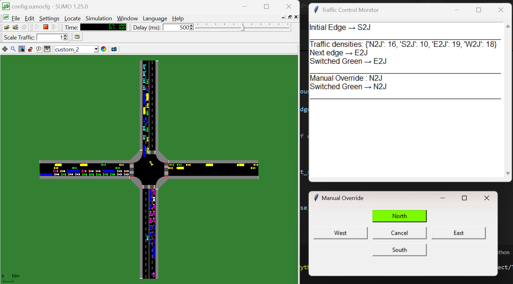

# Traffic Control Using SUMO

An adaptive traffic signal control system built with Python and [SUMO](https://eclipse.dev/sumo/). It monitors traffic density at an intersection, adjusts traffic-light phases dynamically, gives priority to emergency vehicles, and lets an operator override signals manually through a Tkinter GUI.

## Features

- SUMO-based traffic simulation of a single intersection
- Adaptive signal timing based on real-time vehicle density
- Emergency vehicle priority
- Manual traffic-light override through a Tkinter GUI
- Random simulation seed for varied traffic conditions
- Real-time traffic monitoring

## Screenshots

   

## Requirements

- Python 3.8 or newer
- [SUMO](https://sumo.dlr.de/docs/Downloads.php) (includes `sumo` and `sumo-gui`)
- TraCI and sumolib Python packages
- Tkinter (bundled with most Python installers; on Debian/Ubuntu install `python3-tk`)

## Installation

1. Install SUMO and make sure its `bin` folder is on your system `PATH`.
2. Set the `SUMO_HOME` environment variable to your SUMO install folder.
   - Windows (PowerShell): `setx SUMO_HOME "C:\Program Files (x86)\Eclipse\Sumo"`
   - Linux/macOS: `export SUMO_HOME=/usr/share/sumo`
3. Clone this repository:

   ```bash
   git clone https://github.com/SreyaRajanMP/traffic-control-sumo.git
   cd traffic-control-sumo
   ```

4. Install the Python dependencies:

   ```bash
   python -m pip install traci sumolib
   ```

## Usage

Run the controller from the repository folder:

```bash
python Traffic_control.py
```

The SUMO GUI and the traffic monitoring / override windows open automatically.

## How It Works

1. **Start the simulation.** `Traffic_control.py` starts `sumo-gui` with
   `config.sumocfg` and a randomly generated seed. The controller selects one
   of the four directional green phases at startup, so each run can produce
   different traffic conditions.
2. **Measure traffic density.** Each approach (`N2J`, `S2J`, `E2J`, and `W2J`)
   has three lanes. The lane-area detectors in `detectors.add.xml` are
   configured to report once per second, while the controller polls the latest
   detector vehicle counts on every simulation step. It adds the three lane
   counts to calculate one density value for each approach.
3. **Choose the next green phase.** After the current approach has had green
   for 45 seconds, the controller compares the four density values and serves
   the approach with the most vehicles. If there is a tie, it selects the
   approach that has been waiting the longest, using the last-served
   timestamps. The selected approach is mapped to its SUMO traffic-light
   phase in `tls.add.xml`; the other approaches remain red.
4. **Give emergency vehicles priority.** On every simulation step, the
   controller checks detector vehicle IDs and looks for vehicles whose type is
   `emergency`. When one is found, its approach immediately receives the
   corresponding green phase, overriding normal adaptive selection and any
   pending manual request. Emergency priority remains active for up to 45
   seconds before normal control resumes.
5. **Allow manual overrides.** The Tkinter **Manual Override** window has
   buttons for North, South, East, and West. Selecting a direction schedules
   that approach to receive green; the change is applied by the controller on
   the next simulation step and is held until the next 45-second decision. The
   **Cancel** button clears the pending override. Emergency priority always
   takes precedence over manual control.
6. **Monitor the run.** The monitoring window records the initial approach,
   measured densities, selected approaches, phase changes, emergency events,
   and manual override actions while the simulation runs. SUMO also writes
   detector data to `camera-output.xml` and runtime messages to `sumo.log`.

## Project Structure

| File | Purpose |
|------|---------|
| `Traffic_control.py` | Main traffic control program |
| `config.sumocfg` | SUMO simulation configuration |
| `nodes.nod.xml`, `edges.edg.xml`, `connections.con.xml` | Inputs used to build the road network |
| `intersection.net.xml` | Generated road network |
| `routes.rou.xml` | Vehicle routes and traffic demand |
| `detectors.add.xml` | Traffic detector configuration |
| `tls.add.xml` | Traffic-light program definitions |
| `gui-settings.xml` | SUMO GUI appearance settings |
| `netconvert.txt` | Command used to generate the network |

Simulation outputs such as `sumo.log` and `camera-output.xml` are produced at run time and are not tracked in git.

## Rebuilding the Network

If you edit the node, edge or connection files, regenerate the network with `netconvert`:

```bash
netconvert --node-files nodes.nod.xml --edge-files edges.edg.xml --output-file intersection.net.xml --no-turnarounds true --crossings.guess true
```

## Troubleshooting

- **`'sumo-gui' is not recognized` / command not found:** SUMO's `bin` folder is not on your `PATH`.
- **`No module named traci`:** run `python -m pip install traci sumolib`.
- **`No module named tkinter`:** install Tkinter (`sudo apt install python3-tk` on Debian/Ubuntu).

## Results

The simulation demonstrates adaptive traffic-light control at a four-way
intersection:

- The approach with the highest detected vehicle density is selected for the
  next green phase.
- Ties are resolved by serving the approach that has waited the longest.
- Emergency vehicles can immediately pre-empt the normal phase selection.
- Operators can request a directional green phase through the manual override
  window.
- Traffic densities, phase changes, emergency events, and manual actions are
  displayed in the monitoring window.

Detailed detector readings are saved to `camera-output.xml`, and SUMO runtime
messages are saved to `sumo.log`. These files can be used to calculate
quantitative metrics such as average waiting time, queue length, throughput,
and emergency-vehicle travel time for comparisons with a fixed-time signal
baseline.

## Technologies Used

Python, SUMO, TraCI, Tkinter, XML

## Author

[SreyaRajanMP](https://github.com/SreyaRajanMP)
